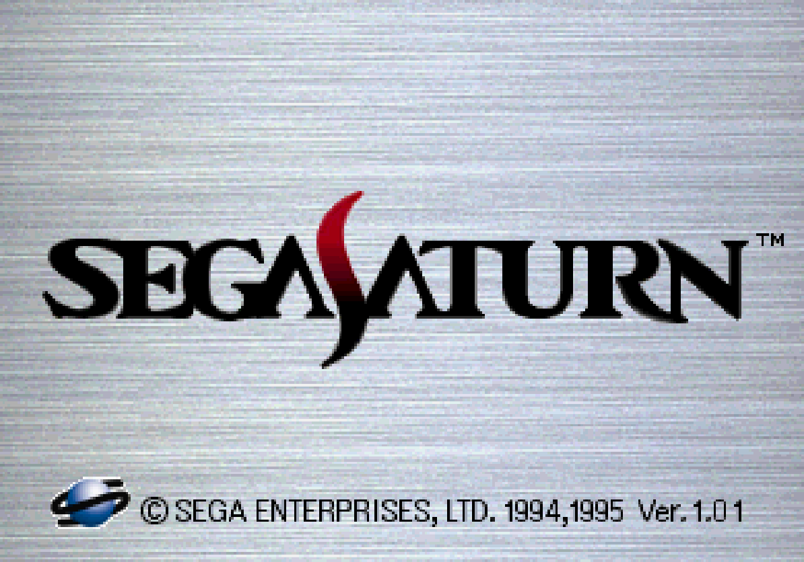
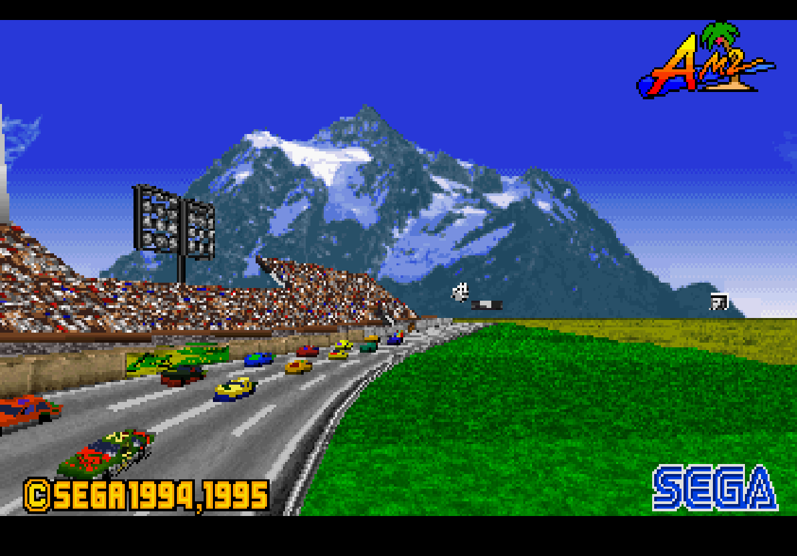
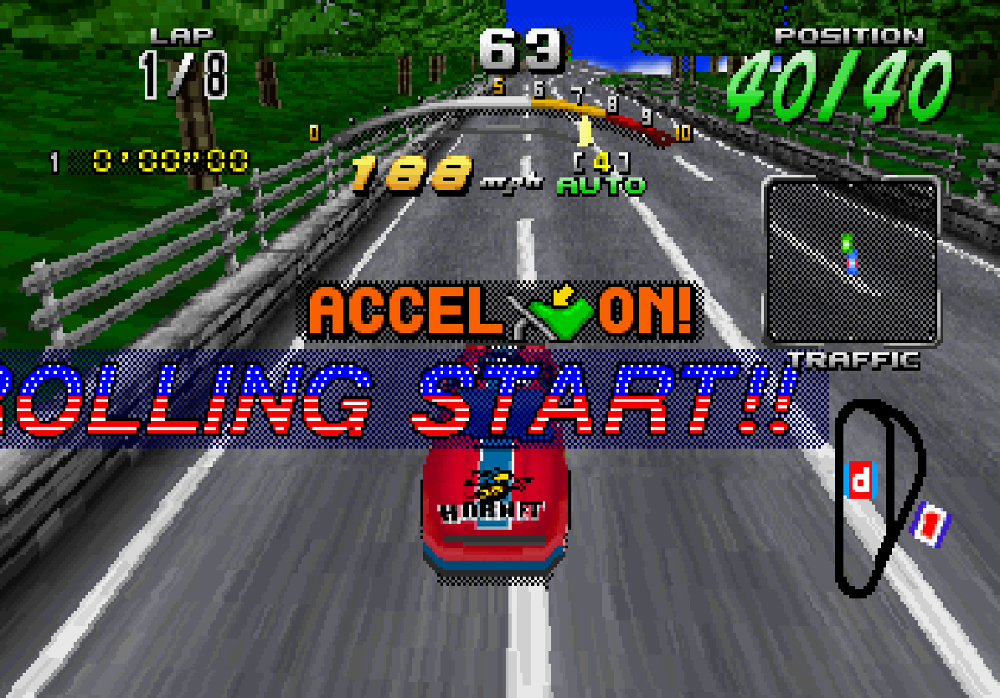
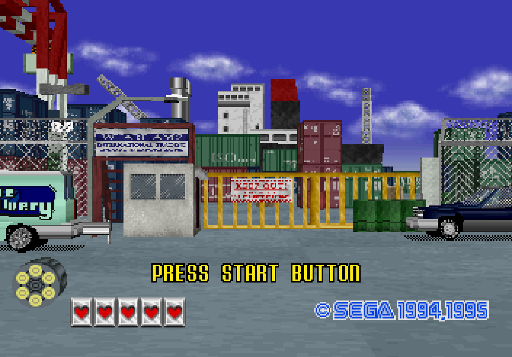
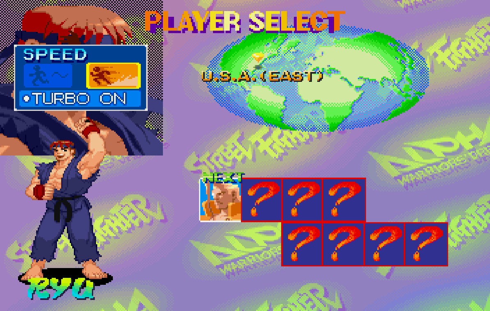
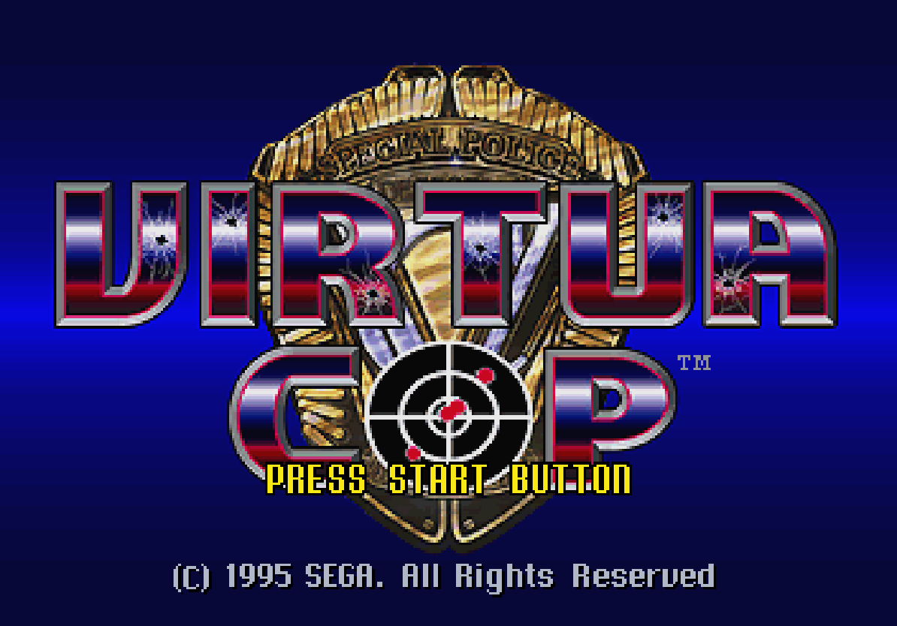
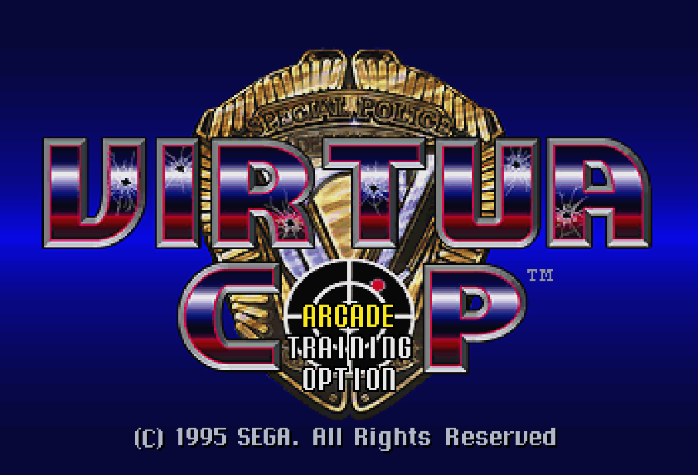
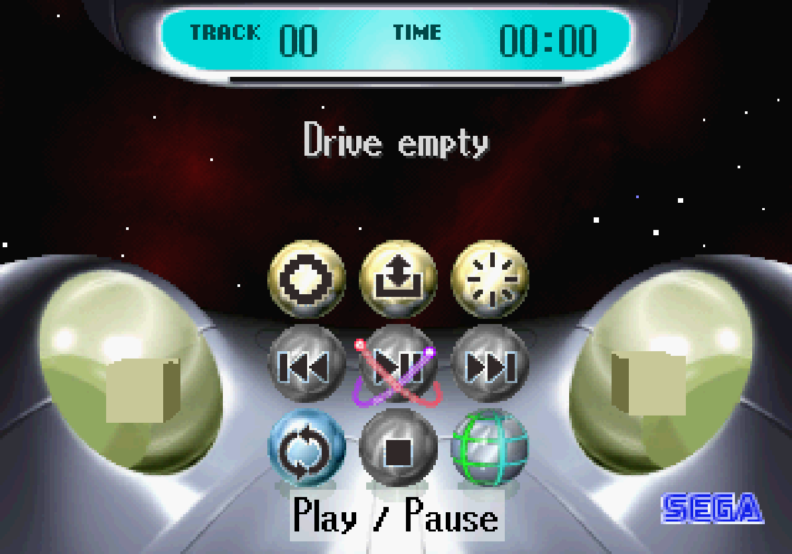

# HTMLSATURN

**A Sega Saturn emulator in plain JavaScript.** No frameworks, no bundler, no build step: clone it,
serve it, run it. Every chip of the console lives in its own file, written to be read and
understood.

<table>
<tr>
<td></td>
<td></td>
</tr>
<tr>
<td></td>
<td></td>
</tr>
<tr>
<td></td>
<td></td>
</tr>
<tr>
<td></td>
<td></td>
</tr>
</table>

*Captured in Chrome from the emulator's canvas.*

---

## Status

The real BIOS boots, and the ten games of the test set start, run and play sound. This is the
health sweep (`diag/health.mjs`): 2,500 frames per game, headless, nobody pressing anything.

| game | boots | a CPU halted | image | colors | audio |
|---|---|---|---|---|---|
| Sega Rally Championship Plus (NetLink Edition) | yes | no | 80 % | 231 | yes |
| Virtua Cop | yes | no | 80 % | 229 | yes |
| Street Fighter Alpha | yes | no | 60 % | 1435 | yes |
| Sonic 3D Blast | yes | no | 40 % | 5317 | yes |
| X-Men: Children of the Atom | yes | no | 56 % | 79 | yes |
| Sega Touring Car Championship | yes | no | 80 % | 275 | yes |
| Daytona USA C.C.E. (NetLink Edition) | yes | no | 76 % | 388 | yes |
| Daytona USA | yes | no | 56 % | 144 | yes |
| Virtua Fighter 2 | yes | no | 64 % | 1129 | yes |
| X-Men vs. Street Fighter | yes | no | 64 % | 79 | yes |

- **boots**: the game leaves the BIOS and runs its own code for at least 60 frames.
- **a CPU halted**: either SH-2 hit an opcode the core does not implement (in practice, a CPU
  sent to execute empty RAM), and stopped.
- **image**: share of the sampled frames with a picture on screen. Attract modes have black
  transitions and FMVs, so 100 % is not the target: the number is there to catch regressions.
- **colors**: the most distinct colors seen in one frame.

In Chrome, measured with the emulator's own frame log: Street Fighter Alpha runs at 60 of 60 frames
per second and Virtua Cop at 58–60; Sega Rally and Touring Car play well (Touring Car draws twice
the pixels of any other game: 704×448, interlaced). **Daytona USA runs at 44–50 of 60**: it is the one case where both bottlenecks (the SH-2 interpreter on the main thread
and the VDP1 rasterizer in its worker) are saturated at once. No frame is dropped and no audio
sample is lost: the emulator slows down instead.

### What works

- **Both SH-2 CPUs** (master and slave), with real per-instruction cycle counts and the on-chip
  peripherals: division unit, DMA controller, free-running timer, watchdog, serial interface,
  interrupt controller and the instruction cache (non-coherent, as on hardware — a game that
  overwrites the slave's code while it runs survives only because of it). Every tricky
  instruction (flags, carries, saturation, MAC) is checked against 6,770 edge cases of its
  reference behavior (`diag/sh2-oracle.mjs`).
- **SCU**: interrupts, the three DMA channels (direct and indirect, with their activation
  factors), timers and the DSP.
- **VDP1**: the command list with normal, scaled and distorted sprites, polygons, polylines and
  lines; Gouraud shading, half-transparency, mesh, end codes and clipping; the double framebuffer
  with manual and automatic erase/swap. It rasterizes in a Web Worker.
- **VDP2**: NBG0–NBG3 (cells and bitmaps), the RBG0 rotation plane with coefficient tables,
  priorities, color calculation, shadows, line color, windows and interlaced hi-res modes. It
  renders in four worker threads, byte-identical to one.
- **SCSP and its 68EC000**: the 32 slots (pitch, envelope, LFO, PCM 8/16), the effects DSP, timers
  and interrupts, CD audio, out through an AudioWorklet.
- **CD block**: all 64 commands, sector buffers, the 24 partitions and the filter chain, the TOC,
  the data transfer to the host and disc authentication; ISO9660; CUE + BIN, ISO, and loose BIN or
  IMG images.
- **SMPC**: INTBACK with peripherals (two pads), the real-time clock and the command timings.
- **Cartridges**: backup RAM (512 KB to 4 MB), RAM expansion (1 and 4 MB) and ROM cartridges.
- **The front end**: BIOS and backup RAM kept in the browser (IndexedDB), a game library, keyboard
  and gamepad mapping for two players, and debug panels (CPU, memory, VRAM, the VDP2 decoder, an
  MMIO log).

### What doesn't, yet

- **Speed in Daytona USA** (see above). The two known ways out were measured before writing
  them and do not get there: splitting the VDP1 rasterizer across threads tops out at 1.45×,
  because 57–59 % of its work (walking the list, interpolating, reading textures) is common to
  every thread; and every avenue tried on the SH-2 interpreter (a JIT prototype among them) came
  out slower. It needs a new idea.
- **VDP1 time-sliced drawing**: the chip-side machinery exists (drawing can stop on a pixel budget
  and resume, `COPR` advances while drawing), but it is not coupled to the worker yet. The `ENDR`
  register and the pseudo draw continuation depend on it.
- **VDP2 VRAM cycle patterns**: who may access each VRAM bank in each cycle is not modeled; VRAM is
  read when needed. Per-line rotation parameter reads are frozen once per frame.
- **Bus wait states**: a B-Bus wait-state model was built and measured, and it does not explain what
  the games do, so it is not used.
- **SMPC**: the INTBACK timing, two commands (`0x0A`, `0x0B`) that Sega Rally and Daytona CCE send
  and that no known source describes, `SYSRES`, and clock change beyond the 320/352 dot select.
- **SH-2**: the user break controller (debug only) and the bus state controller's wait states and
  refresh.
- **Sprite priority** in some screens is reported wrong and not reproduced yet.

### What is not emulated, on purpose

- **The optical drive's mechanics.** This emulates a Saturn with an optical drive emulator that
  replaces only the drive (MODE-style): the CD block and its command latency are there, the seek
  time and rotational latency of a spinning disc are not. Those devices run the library without
  known problems, so modeling the mechanics would move away from a configuration that works.
- **No silent fallback.** If the video worker cannot start, the emulator says so; it does not drop
  to a slower path that would hide the bug.
- **Features no game in the test set uses** (special color calculation, the sprite window, VDP1
  high-speed shrink, the light gun, SCI interrupts): marked in the code with `//?` where they would
  go, instead of being guessed.

---

## Getting started

You need [Node.js](https://nodejs.org) 18 or later and a Chromium-based browser. **You also need your own Saturn
BIOS and your own game discs**: neither is included, and neither can be.

```bash
node serve.mjs --sab
```

Then open http://localhost:8080/index.html, load the BIOS once (it stays in the browser) and load a
disc (a CUE with its BIN tracks, an ISO, or a loose BIN or IMG).

`--sab` makes the server send the COOP/COEP headers. With them the page is cross-origin isolated,
`SharedArrayBuffer` exists, and the VDP1 worker and the four VDP2 threads share memory with the
emulator. Without them everything still works through message copies, about 1 ms slower per frame.
Opening `index.html` from disk (`file://`) does not work: browsers block workers there.

### Headless

The same chips run in Node without a browser, which is how the tests and probes work. Put your BIOS
images in `bios/` and your discs in `roms/`, one folder per game (`BIOSES` and `GAMES` in
`headless.mjs` list the names it expects; any other path works too).

```bash
node headless.mjs rally 2000
```

```bash
node sh2.test.mjs
```

```bash
node diag/baseline.mjs
```

`diag/baseline.mjs` runs every test, the SH-2 oracle, the state, video and audio hashes and the
health sweep, and prints them in a fixed format: two runs compare with a `diff`.

---

## How it is built

| file | what it is |
|---|---|
| `sh2.js` | the SH-2 CPU core and its on-chip peripherals (instantiated twice: master and slave) |
| `bus.js` | the memory map and the glue: SMPC, CD block, SCU DMA and interrupts, backup RAM |
| `scu.js` | the SCU DSP |
| `vdp1.js`, `vdp1-worker.js` | the sprite/polygon processor and its rasterizer worker |
| `vdp2.js`, `vdp2-worker.js` | the background processor and its band-rendering workers |
| `scsp.js`, `m68k.js`, `audio-worklet.js` | the sound processor, the 68EC000 adapter and the audio output |
| `cd.js` | the disc image reader (CUE/BIN, ISO, ISO9660) |
| `cart.js` | the cartridge slot |
| `scheduler.js` | the event scheduler that interleaves the chips |
| `disasm.js` | the SH-2 disassembler for the debug panels |
| `index.html` | the page: front end, the frame loop and the worker coupling |
| `headless.mjs`, `serve.mjs` | the Node harness and the development server |
| `vendor/estyjs-processor.js` | the 68000 core (EstyJS, GPL) |

**Emulation and presentation are decoupled.** Everything with an effect on the hardware —
registers, framebuffers, interrupts, edge-triggered flags— happens inside `runFrame()`, which is
the console's timing. The canvas only composes the output, at whatever rate the monitor runs.
Hanging logic off the paint would make the emulation depend on the browser's frame rate.

**The hardware takes time.** Chips that answered with zero latency broke the handshakes games
program (lower a flag, write a command, wait for the flag). Giving the CD block its real command
latency (~333 µs) fixed four games at once. **And registers are edge-triggered, not level**: a
register the chip consumes on the write must not be sampled once per frame, or every short pulse a
game writes is lost.

## How it is checked

- **Fidelity to the real hardware first.** When in doubt, what the hardware does wins over what makes
  a game run. Other emulators are hints, and code taken from them says so in a comment.
- **The criterion is the specification, not the games.** The model is `diag/sh2-oracle.mjs`: the
  expected results come from outside the emulator, so a test cannot fossilize a bug.
- **No probe reports without a control**: a run where the answer is already known. **Every
  optimization must be faster and leave the hash identical.** A/B runs are interleaved and their
  order is counterbalanced, because the branch that runs first wins by a few percent on its own.
  **The ceiling is measured before a refactor is written.**
- `diag/` holds the probes; `PENDING.md` indexes them, records what is left with its measurements,
  and keeps the list of hypotheses that were measured and died, so nobody proposes them again.

## Credits and legal

HTMLSATURN is distributed under the **GNU GPL v2 or later** (see `LICENSE`). It includes or ports
code from EstyJS (the 68000 core), Yabause and Mednafen, all GPL; see `CREDITS.md` for what came
from where. Dexie.js is Apache-2.0.

No BIOS, game or disc image is included, and none is downloaded by the emulator: everyone uses
their own. Sega and Sega Saturn are trademarks of Sega Corporation. This project is not affiliated
with or endorsed by Sega.
